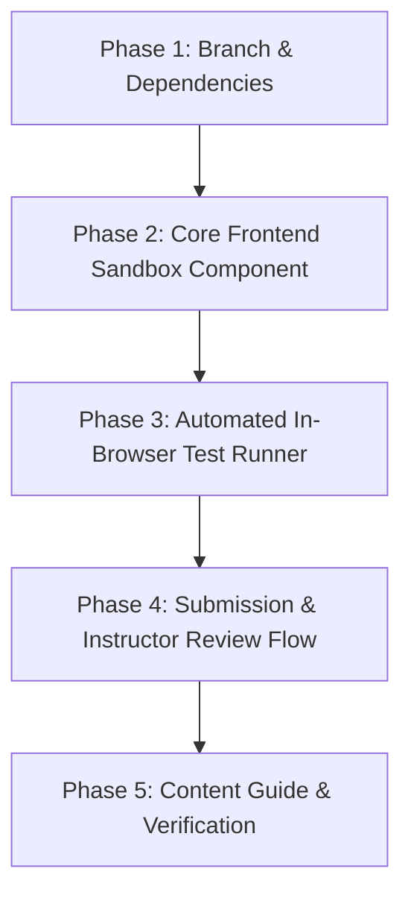

# Implementation Plan: Smart Article Frontend Sandpack & In-Browser Automated Grading

## 1. Executive Summary
This implementation plan outlines the architecture, integration, and deployment of a full **in-browser frontend coding sandbox and automated grading system** for LearnHouse Smart Articles.

It empowers instructors to author rich frontend courses covering **HTML, CSS, Vanilla JavaScript, React (JSX/TSX), Tailwind CSS, and Next.js**, allowing students to write code across multiple files, view instant live visual previews, and receive immediate **automated test grading** without ever leaving the LMS or incurring external server costs.

---

## 2. Core Objectives & Key Requirements
1. **Universal Frontend Framework Support:**
   * Support HTML, CSS, JavaScript, React 19 / JSX, and modern utility-first CSS (**Tailwind CSS**).
   * Enable multi-file project structures (e.g., `App.jsx`, `components/Card.jsx`, `styles.css`, `index.html`).
2. **Zero-Latency In-Browser Execution:**
   * Run completely inside the student's browser using `@codesandbox/sandpack-react` web workers.
   * Eliminate backend server requirements, Docker provisioning, and container compute costs for frontend rendering.
3. **Automated In-Browser Grading:**
   * Run automated assertions directly against the rendered preview (DOM elements, Tailwind utility classes, text content, and interactive click/input state mutations).
   * Support component-level unit test suites (e.g. `@testing-library/react`) for advanced React exercises.
   * Calculate score percentages against customizable passing thresholds (e.g., 80% or 100%) to unlock lesson progression.
4. **Seamless Student Submission & Instructor Review:**
   * Serialize student code files and test logs directly into the course activity progress record.
   * Allow instructors to view student submissions in the instructor dashboard with the code editor and live interactive preview running side-by-side.
5. **AI Authoring Compatibility (ChatGPT):**
   * Expand the Smart Article schema with `FRONTEND_EXERCISE`.
   * Enable ChatGPT to generate complete frontend interactive lessons in Option B JSON (or embedded in PDF) without secondary processing.

---

## 3. Technology Stack & Architectural Decision

### Why Sandpack (`@codesandbox/sandpack-react`)?
* **Industry Standard:** Sandpack powers the official [react.dev](https://react.dev) docs, Tailwind CSS play docs, and freeCodeCamp.
* **Isolated Security Sandbox:** Executes all user-generated code inside sandboxed `<iframe>` instances with strict origin policies, preventing security risks to LearnHouse's auth cookies and session storage.
* **In-Memory Bundler:** Compiles React JSX, resolves NPM dependencies dynamically via CDN (esm.sh / unpkg), and injects Tailwind CSS compiler entirely in a Web Worker.

| Requirement | Native `<iframe>` Sandbox | Headless Piston Container | Sandpack (`@codesandbox/sandpack-react`) |
| :--- | :--- | :--- | :--- |
| **HTML / CSS / JS** | ✅ Works | ❌ No visual rendering | ✅ Supported (`"static"`, `"vanilla"`) |
| **Tailwind CSS** | ⚠️ CDN script only | ❌ No visual rendering | ✅ Native support |
| **React Components & JSX** | ❌ Complex Babel setup | ❌ No visual rendering | ✅ Native in-memory bundler |
| **Multi-File Projects** | ❌ Difficult to manage | ⚠️ Terminal only | ✅ Out-of-the-box tabs & file tree |
| **Live Visual Preview** | ✅ Yes | ❌ Terminal text only | ✅ Real-time responsive iframe |
| **Automated DOM/State Tests** | ⚠️ Manual bridge | ❌ Cannot test DOM/CSS | ✅ Native event & DOM inspection |
| **Server & Compute Cost** | Free | Requires Docker per run | **100% Free (Client-Side)** |

---

## 4. Smart Article Schema Specification (`FRONTEND_EXERCISE`)

In `apps/api/src/services/courses/activities/smart_article.py` and the course JSON schema, we register the new block type:

```json
{
  "type": "FRONTEND_EXERCISE",
  "title": "Interactive Product Card with Tailwind",
  "template": "react", 
  "instructions": "### Assignment Goals\n1. Use Tailwind classes to create a card with `rounded-2xl`, `shadow-xl`, and `p-6`.\n2. Implement a count state that increments when the 'Add to Cart' button is clicked.",
  "activeFile": "/App.jsx",
  "files": {
    "/App.jsx": "import React, { useState } from 'react';\n\nexport default function App() {\n  const [count, setCount] = useState(0);\n  return (\n    <div id=\"product-card\" className=\"max-w-sm bg-white p-6 rounded-2xl shadow-xl space-y-4\">\n      <h2 className=\"text-xl font-bold text-gray-900\">Wireless Headphones</h2>\n      <p className=\"text-gray-500\">Studio-grade noise cancellation.</p>\n      <button \n        id=\"add-btn\"\n        onClick={() => setCount(count + 1)}\n        className=\"px-4 py-2 bg-blue-600 text-white rounded-lg hover:bg-blue-700 transition\">\n        Add to Cart ({count})\n      </button>\n    </div>\n  );\n}",
    "/styles.css": "@tailwind base;\n@tailwind components;\n@tailwind utilities;"
  },
  "hiddenFiles": {
    "/package.json": "{\n  \"dependencies\": {\n    \"react\": \"^19.0.0\",\n    \"react-dom\": \"^19.0.0\",\n    \"lucide-react\": \"^0.552.0\"\n  }\n}"
  },
  "passingScore": 100,
  "tests": [
    {
      "id": "test_heading",
      "description": "Renders product title 'Wireless Headphones'",
      "type": "dom_text",
      "selector": "h2",
      "expected": "Wireless Headphones"
    },
    {
      "id": "test_tailwind_classes",
      "description": "Card uses required Tailwind classes (rounded-2xl, shadow-xl)",
      "type": "class_contains",
      "selector": "#product-card",
      "requiredClasses": ["rounded-2xl", "shadow-xl", "p-6"]
    },
    {
      "id": "test_interactivity",
      "description": "Clicking 'Add to Cart' increments count to 1",
      "type": "interaction",
      "action": "click",
      "targetSelector": "#add-btn",
      "assertSelector": "#add-btn",
      "expectedText": "Add to Cart (1)"
    }
  ],
  "solution": {
    "/App.jsx": "/* Full instructor reference solution */"
  }
}
```

---

## 5. Automated In-Browser Grading Engine

### A. Execution Mechanism
Automated grading runs inside the student's browser via an assertion runner embedded in the preview iframe bridge.

```
+-------------------------------------------------------------+
|                      LearnHouse LMS                         |
|                                                             |
|  +---------------------------+  +------------------------+  |
|  |     Sandpack Editor       |  |    Sandpack Preview    |  |
|  |  [App.jsx] [styles.css]   |  |   (Sandboxed <iframe>) |  |
|  |                           |  |                        |  |
|  |  Student edits code...    |  |  Hot-reloads live DOM  |  |
|  +---------------------------+  +-----------+------------+  |
|                                             |               |
|  [Run Tests & Submit Grade]                 v               |
|  ================================> +---------------------+  |
|                                    | Automated Test      |  |
|                                    | Engine Runner       |  |
|                                    | - DOM selector check|  |
|                                    | - Tailwind class check|
|                                    | - Synthetic click/event|
|                                    +----------+----------+  |
|                                               |             |
|  +--------------------------------------------v----------+  |
|  | Test Results Drawer:                                  |  |
|  |  ✅ [Passed] Product title renders correctly          |  |
|  |  ✅ [Passed] Card contains required Tailwind classes  |  |
|  |  ✅ [Passed] Counter increments on click              |  |
|  |  Grade: 3/3 (100%) - Step Completed!                  |  |
|  +-------------------------------------------------------+  |
+-------------------------------------------------------------+
```

### B. Supported Test Types
1. **`dom_text`**: Queries an element with CSS selector and validates exact or partial text match.
2. **`dom_exists`**: Verifies that specific elements (tags, IDs, classes) exist in the hierarchy.
3. **`class_contains`**: Verifies that Tailwind CSS utility classes exist on the target element (e.g. `bg-blue-600`, `flex`, `grid`, `rounded-xl`).
4. **`css_computed_style`**: Checks computed CSS rules (e.g., `display: flex`, `color: rgb(37, 99, 235)`).
5. **`interaction`**: Dispatches synthetic browser events (`click`, `change`, `input`) and tests resulting DOM state changes.
6. **`component_test`** (Advanced): Executes `@testing-library/react` assertions inside Sandpack's test client runner.

### C. Grade Calculation & Course Progression
* **Score Formula:**
  $$\text{Score (\%)} = \left(\frac{\text{Tests Passed}}{\text{Total Tests}}\right) \times 100$$
* If $\text{Score} \ge \text{passingScore}$ (default: 100%):
  * Step status turns green (`Completed`).
  * Triggers celebratory feedback toast & sound.
  * Records completion in student course progress.
* If $\text{Score} < \text{passingScore}$:
  * Displays actionable failure hints pointing directly to the failing test and line.
  * Student can revise their code and re-run tests instantly with zero penalty.

---

## 6. Component Architecture & File Plan

### 1. New Component: `FrontendExerciseBlock.tsx`
* **Location:** `apps/web/components/Objects/Activities/SmartArticle/Blocks/FrontendExerciseBlock.tsx`
* **Features:**
  * Uses `SandpackProvider`, `SandpackLayout`, `SandpackCodeEditor`, `SandpackPreview`.
  * Support for templates: `"react"`, `"react-ts"`, `"vanilla"`, `"static"`, `"nextjs"`.
  * Multi-file tabs with file creation/reset capabilities.
  * Split-pane layout with responsive toggle for small screens (Editor Tab / Preview Tab).
  * Built-in console drawer for `console.log` output.
  * Test results panel displaying live test execution, progress bar, and pass/fail cards.

### 2. In-Browser Test Runner Service: `frontendTestRunner.ts`
* **Location:** `apps/web/lib/testing/frontendTestRunner.ts`
* **Features:**
  * Extracts the preview iframe document via `sandpack.iframe`.
  * Executes asynchronous test assertions in serial with 2-second timeout protection.
  * Generates structured results: `{ passed: boolean, score: number, results: [...] }`.

### 3. Smart Article Activity Integration: `SmartArticleActivity.tsx`
* **Location:** `apps/web/components/Objects/Activities/SmartArticle/SmartArticleActivity.tsx`
* **Changes:**
  * Add case `'FRONTEND_EXERCISE'` in `renderStep()`.
  * Render `<FrontendExerciseBlock step={step} />`.

### 4. Instructor Grading / Review Interface
* **Location:** `apps/web/components/Objects/Activities/SmartArticle/Review/FrontendReviewObject.tsx`
* **Features:**
  * Renders student's submitted files in read-only Sandpack.
  * Displays student's automated test results log.
  * Allows instructors to run the student's live app interactively.
  * Provides manual grade adjustment and feedback comments.

---

## 7. ChatGPT Prompt & Content Guide Updates

Update `docs/smart_article_content_guide.md` with rules for ChatGPT:
1. Explain the distinction:
   * **`CODE_EXERCISE`**: For Backend / Algorithms (Python, Node.js, Express, Go, C++). Runs in headless Piston.
   * **`FRONTEND_EXERCISE`**: For HTML, CSS, JavaScript, React, Tailwind CSS. Runs in Sandpack with live preview and automated DOM tests.
2. Provide copy-paste JSON templates for:
   * HTML/CSS/Tailwind landing page sections.
   * React interactive state components with automated tests.

---

## 8. Implementation Roadmap & Phased Execution



### Phase 1: Branch & Dependencies Setup
1. Create dedicated branch: `feat/smart-article-frontend-sandpack`.
2. Install `@codesandbox/sandpack-react` in `apps/web` via `pnpm add @codesandbox/sandpack-react`.
3. Verify bundle compatibility with Next.js 16 and Turbopack.

### Phase 2: Core Frontend Sandbox Component
1. Build `FrontendExerciseBlock.tsx` in `apps/web/components/Objects/Activities/SmartArticle/Blocks/`.
2. Configure theme styling matching LearnHouse dark/light design system.
3. Wire into `SmartArticleActivity.tsx` under case `'FRONTEND_EXERCISE'`.

### Phase 3: Automated In-Browser Test Runner
1. Implement `frontendTestRunner.ts` supporting DOM, Tailwind classes, and synthetic interaction testing.
2. Build `TestResultsDrawer.tsx` showing granular pass/fail checks, error messages, and grade calculation.
3. Hook tests into lesson step completion status.

### Phase 4: Submission & Instructor Review Flow
1. Wire "Submit Task" to save student's file state and test score into activity progress.
2. Build instructor view component to load student submissions in live preview.

### Phase 5: Documentation & End-to-End Verification
1. Update `docs/smart_article_content_guide.md` with `FRONTEND_EXERCISE` block specs.
2. Update `docs/stable_state_checkpoint.md` with new capabilities.
3. Test with sample HTML/CSS, Tailwind, and React lessons.
